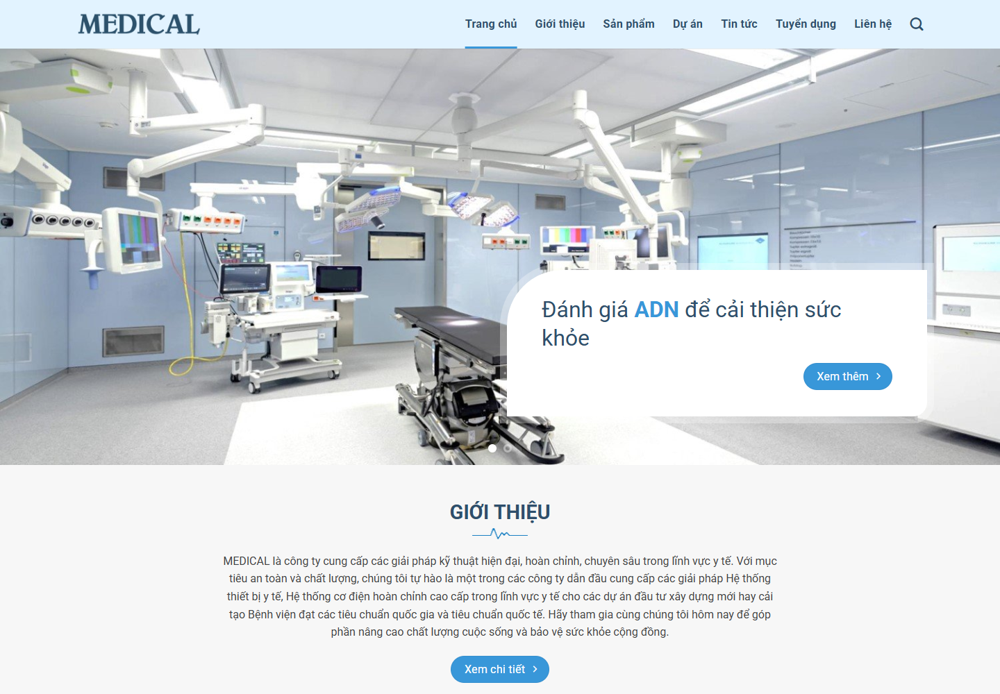
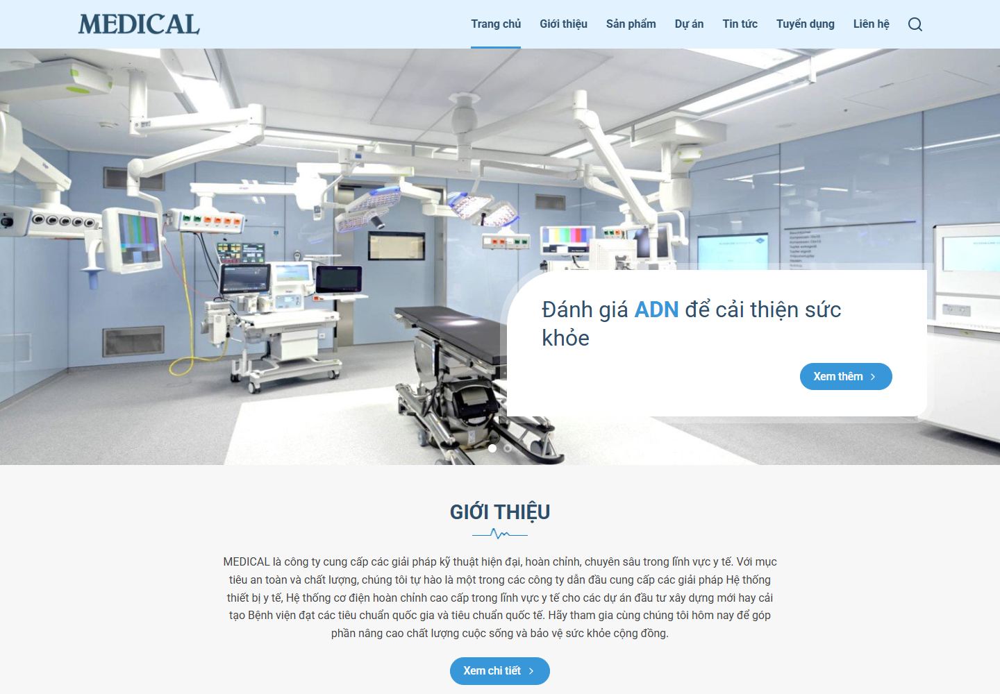
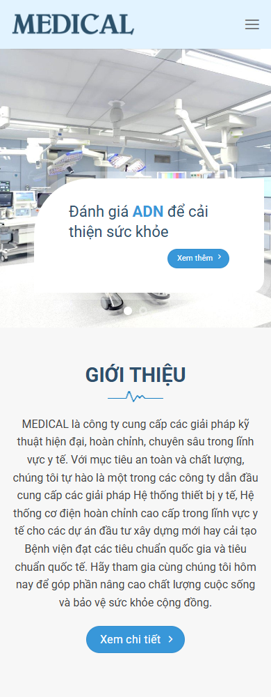

# MEDICAL homepage clone

Source: https://0141.matbao.website/

## Route and ownership

| Source | Local | Files |
| --- | --- | --- |
| `/` | `/` | `src/app/page.tsx`, `src/components/sites/medical/MedicalHome.tsx`, `src/components/sites/medical/content.json` |

Shared layout and styling: `src/app/layout.tsx`, `src/app/globals.css`, `src/app/fonts.css`. Original images, decorative assets, and locally hosted Roboto fonts: `public/sites/medical/`.

The starting homepage was the untouched template. The implementation now includes the homepage, introduction, contact, all 50 published article/product/project/brand pages, all 14 category archives, archive pagination, and the author archive. Search runs locally through `/?s=...`. Menu, sidebar, homepage cards, and article navigation use local destinations.

Additional ownership: `src/app/[...path]/page.tsx`, `src/components/sites/medical/MedicalPages.tsx`, `PageInteractions.tsx`, `site-content.ts`, `site-data.json`, and `src/app/inner-pages.css`. The existing homepage styles and sections are retained. See [the additional page report](pages/README.md) for routes and comparison evidence.

## Observations

- Colors: primary `#3897d9`, headings `#2e4f6c`, body `#414141`, section background `#f7f7f7`.
- Content container: 1250px. Header: 70px. Hero: 600px desktop, 400px below 850px.
- Roboto regular, medium, and bold. Decorative heartbeat underlines use source images.
- Hero switches every six seconds, pauses on hover, and supports arrows, dots, and touch swipes.
- Product grid has 6/3/3, 3/6/3, and 4/4/4 column proportions. Mobile cards stack.
- Four alternating service sections; their illustrations precede text on mobile.
- Source project category tabs repeat the same three projects. This behavior is preserved.
- Remaining sections: reasons to choose MEDICAL, projects, six news cards, recruitment benefits, partner gallery, registration, contact map, and four-column footer.

## Validation

`npm.cmd run check` passes ESLint, TypeScript, and the optimized production build.

Chrome inspection covered 390px, 768px, 1440px, and 1920px widths. Browser validation found no page errors, broken local images, or horizontal overflow. Exercised hero navigation, project tabs, search entry, mobile menu opening/closing, partner lightbox, contact form validation/local save, and back-to-top.

Run locally with `npm.cmd run dev`, then open http://localhost:3000/.

### Desktop comparison (1440px)

Source:

Clone:

### Mobile comparison (390px)

Source:

Clone:

Full-page screenshots use the same filename pattern ending in `-full.png`. `source-details.json`, `comparison.json`, and `local-validation.json` contain inspection evidence. `asset-map.json` records the original uploaded asset URLs and local filenames. Three decorative images and Roboto font files were fetched separately by `scripts/extract-medical.cjs`.

## Functional and visual limits

- The contact form validates and stores a request in browser localStorage; its feedback explicitly states that it has not sent the request and supplies email/telephone contact options. No mail backend was supplied.
- Some icon shapes, mobile section spacing, and carousel transitions differ slightly from the source. This is a close recreation, not a verified pixel-perfect match.
- The map remains an external Google Maps embed, matching the source integration.
- Social links on the source have no configured account destinations. The clone currently links to each platform's homepage.

Inspection scripts depend on a locally available Chrome and the temporarily installed Playwright tooling. These are development tools, not runtime dependencies of the clone.
