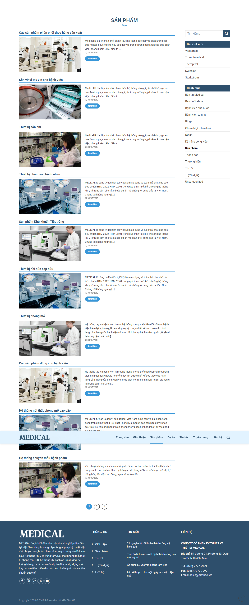
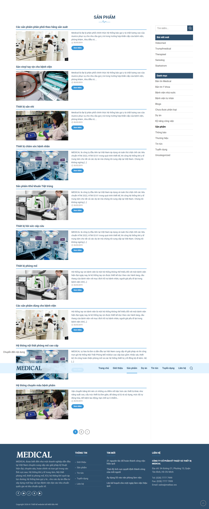
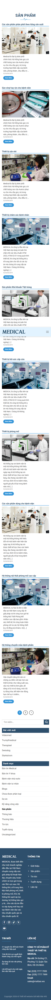
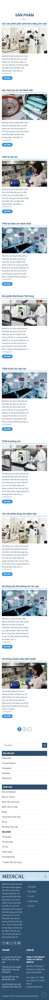

# Additional pages

The clone now implements the source site's public content locally. The source API supplied 50 posts and 14 categories. Original post bodies are stored as sanitized editorial HTML in `site-data.json`; site layout and controls are React components, not downloaded WordPress scripts or page bundles.

| Source path | Local path | Implementation |
| --- | --- | --- |
| `/gioi-thieu/` | Same | About banner, mission statement, original city image |
| `/lien-he/` | Same | Shared contact map and registration form |
| `/category/san-pham/` | Same | Product archive with pagination and sidebar |
| `/category/du-an/` | Same | Project archive with pagination and sidebar |
| `/category/tin-tuc/` | Same | News archive and sidebar |
| `/category/tuyen-dung/` | Same | Recruitment archive with original source content |
| Remaining category paths and `page/N/` | Same | Shared archive renderer |
| All 50 article slugs | Same | Full editorial content, category links, author, sharing, adjacent articles, comment form |
| `/author/system/` | Same | Author archive |
| `/?s=keyword` | Same | Local search with accent-insensitive matching and empty state |
| `/trang-chu/` | `/` redirect | Homepage alias |

The source recruitment archive reuses two work-skills articles; the clone preserves this content. Some source editorial images referenced an obsolete hostname; the clone downloads those images from the current hostname and hosts them locally.

## Checks and evidence

- Production lint, TypeScript, and build are run with `npm.cmd run check`.
- `validation.json` records HTTP route checks, desktop/mobile rendering, asset checks, runtime errors, overflow, and interaction results.
- Source screenshots: `<slug>-desktop.png` and `<slug>-mobile.png`.
- Clone screenshots: `local-<path>-1440-top.png`, `local-<path>-1440-full.png`, and the corresponding `390` screenshots.
- `evidence.json` records source text, observed links, and layout measurements.
- `asset-map.json` maps additional editorial images and introduction imagery to local assets.

Representative desktop comparisons:

Representative mobile comparisons:

## Limits

Contact requests and comments validate in the browser and save locally. Feedback explicitly distinguishes local saving from sending to a server; no live mail or comment backend is connected. Share buttons open their respective external sharing destinations. The map remains the source Google Maps integration. Minor typography, icon, and vertical spacing differences remain.
